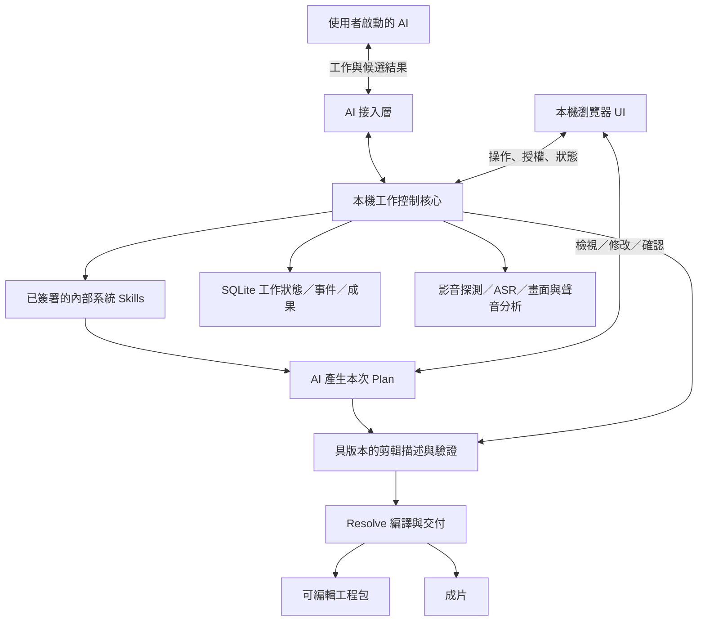

# Clipen 產品架構

這份文件是可隨產品發布的架構基準。細部開發筆記、個人 AI 設定與開發 Skills
不收錄於 repo。**這是目標設計，不是已完成的功能清單**；實作進度以 README 為準。

## 使用者體驗

進入專案，以指令啟動自己的 AI；完成首次設定與必要授權後，AI 接上 Clipen
便自動開啟本機 UI，不需要再輸入「幫我開 UI」。啟動不代表已授權掃描或剪輯。

介面以桌面瀏覽器為目標；手機版不在開發與驗收範圍。版面仍須容許桌面視窗
縮放、分割視窗與瀏覽器縮放，並保留鍵盤操作及基本可及性。既有窄視窗樣式
作為桌面操作的容錯，不視為手機支援承諾，也不另做手機專用功能或驗收矩陣。

日常命令就是在 clone 後的 repo 根目錄執行 `codex` 或 `claude`，不要求
`python -m ... launch`、手動開服務或補一段啟動提示。repo 隨附產品級 MCP
設定，由支援的 CLI 在使用者批准專案信任／MCP 後載入；完成 MCP 初始化才
啟動 UI。CLI 不支援這種載入方式時明確標示不相容，不以 wrapper 算成驗收。
首次安裝 Python／AI CLI、登入與必要授權屬前置條件，不能省略或自行批准。

1. 使用者提供範例作品與毛片目錄，確認讀取及送給所選 AI 的資料範圍。
2. 實際分析畫面與聲音；以語音辨識產生附來源時間的逐字稿。
3. AI 依內部系統 Skills、使用者需求、毛片分析及有提供的範例，產生本次剪輯
   計畫（Plan）。使用者檢視並修改計畫，不檢視或編輯系統 Skill 原文。
4. 使用者確認開始；AI 決定片段、節奏、文字與效果，受控工具執行。
5. 使用者預覽與提出修改；接受版本後，才選擇成片或 Resolve 可編輯工程。
6. 中斷後重新核對工作狀態，重用已驗證成果；不盲目重做外部操作。

## 模組與責任

| 模組 | 負責 | 不負責 |
| --- | --- | --- |
| 啟動與 AI 接入 | 原 session 綁定、能力核對、自動開 UI、工作往返 | 偷開另一個付費模型冒充原 AI |
| 本機 UI | 素材授權、Plan 檢視／編輯／確認、開始／取消、預覽與交付 | 公開系統 Skill 原文、直接執行 shell、改資料庫 |
| 工作核心 | 檢查權限與版本、排程、狀態轉移、成果驗證、恢復 | 將模型自述當作執行成功 |
| 系統 Skills | 內部核心流程與剪輯判斷方法 | 作為使用者可編輯文件或直接複製成 Plan |
| 剪輯計畫 Plan | 綁定本次需求與素材的創作安排、版本與使用者確認 | 替代系統規則、提高授權、冒充已執行成果 |
| 媒體分析 | 來源識別、影音探測、ASR、帶時間與覆蓋範圍的證據 | 將逐字稿等同於完整的影音理解 |
| 剪輯描述 | 片段、軌道、文字、插圖、效果與來源的版本快照 | 執行任意模型程式碼或原始 Fusion 腳本 |
| Resolve 交付 | 專用工程、有限效果映射、預覽、工程包與成片 | 覆蓋使用者既有工程、把壓平影片稱為可編輯 |

完整應用採本機模組化單體：單一工作控制程序、受管理的重運算程序、SQLite
與本機成果儲存。Python 後端與瀏覽器 UI 分離；正式 UI／HTTP 框架在技術原型
驗證後整合。原型可縮小技術規模，但不得宣稱已實作完整架構。

## 必須維持的邊界

### AI 與使用者授權

- UI 與本次 AI terminal 綁定：啟動時自動開頁並在 terminal 提供本機重開連結。
  只關分頁不停止服務；terminal／AI 程序結束時停止本機服務，舊連結失效，
  留下的分頁停用操作。持久化紀錄保留，不等同於背景繼續執行工作。
- 重啟建立新的服務與開頁權限；恢復未完成工作需要核對及必要的重新授權。
  普通瀏覽器不保證允許程式自動關閉分頁，因此「關 UI」以停止服務並停用
  工作台為必要保證，不關閉使用者整個瀏覽器。
- Codex、Claude、Gemini 與本機 LLM 是目標入口，每個入口均需獨立實測。
  找到 executable 或完成 MCP 握手，不等於模型已能持續接收 UI 工作。
- 工作往返需使用啟動時的 AI session；若供應商不支援，要明示限制。
  不使用鍵盤注入、修改私有對話檔或略過供應商權限提示。
- UI 點擊送出才授權該筆資料交給已連接 AI；雲端 AI 的處理不會因 UI 在本機
  就自動變成完全離線。不得背景上傳整個素材目錄。
- AI 接入工具只可取已授權工作、提交候選與查詢狀態，不能自行批准開始或交付。

### Skills 身分

固定 core 負責流程，系統 editing Skills 提供內部剪輯判斷方法。系統來源由
簽章清單、發行指紋與實際內容驗證；原文只交給需要它的後端／AI 執行上下文，
不進入瀏覽器狀態 API、前端資產或計畫正文，也不提供複製原文的使用者功能。
若提供風格選擇，只發布獨立編寫的名稱、用途與可調參數，不直接摘錄內部指令。

目前 SkillStore 的 `user:` 與 `.clipen/user-skills/` 是既有隔離文字儲存原型，
不是正式 Plan 編輯器、計畫版本或確認機制。不得將它直接當作已確認的計畫執行。
本機管理員仍能讀取明文檔案、改程式與信任資料；隱藏 UI 不是 DRM 或保密保證。詳見
[Skills 保護說明](docs/SKILL_PROTECTION.md)。

### 使用者可編輯的剪輯計畫（Plan）

原先稱「可編輯 Skill」的產品項目，現在定義為 **本次作品的 Plan**，不是可重用
的系統提示詞。來源包含系統規則、需求與毛片分析；有範例時再加入其可觀察風格。
缺少分析時只列需求草稿與未知，不捏造片段或時間點，也不能確認為可執行版本。

| 計畫內容 | 定義 |
| --- | --- |
| 目標與限制 | 本次目的、受眾、長度／畫幅、必留與不可使用內容 |
| 段落與選材 | 段落順序、素材 ID、來源區間、保留／刪除理由及分析證據 |
| 表現安排 | 節奏、字幕文案／樣式、聲音、插圖與支援的效果安排 |
| 未知與衝突 | 未分析素材、缺少權限、不可實現的效果與待確認事項 |
| 版本與來源 | plan ID／revision、需求／素材／分析／能力快照；內部規則引用由後端保存 |

AI 產生草稿 → 使用者修改或要求重生成 → 後端核對素材／能力／授權 → 使用者
確認特定 revision 並開始剪輯。每次修改產生新版本，舊版確認不可自動套用新版；
執行中修改草稿不得改寫已凍結的執行計畫。Plan 不含任意 shell／檔案操作或系統
指令；使用者可調整創作決策，不能藉此關閉驗證、擴大資料存取或更改付費授權。
匯出選擇仍留在剪輯完成後；規劃時須檢查支援的可編輯交付能力。

目前原型只移除系統內容公開並顯示 Plan 未實作狀態；**尚無 AI 計畫生成、編輯器、
revision 儲存、確認或執行端點**。文字測試回覆不是 Plan，也不視為開始剪輯。

### 工作與恢復

- 同一 workspace 只允許一個 writer；狀態、事件與命令回執在同一交易保存。
- 原型的額外 MCP 工具探索連線只提供靜態清單，不持有資料庫、不讀取工作、
  不開頁也不接管原連線；未完成初始化前不建立工作目錄。工具可見不是處理就緒。
- 命令具 request ID 與預期版本；同筆重送回原回執，不重複開工。
- operation 表示一次邏輯工作，attempt 表示一次執行。連線、執行、驗證成功
  是不同狀態；舊 generation 的遲到回覆不能推進新工作。
- 取消／暫停意圖持久化。斷線或重啟不能自動將取消工作恢復為執行中。
- 已送到 AI 或 Resolve 的操作若結果未知，先核對；沒有查詢證據時等待使用者
  決定，不自動重送付費 prompt 或重建工程。
- 暫存 system log 是可重建的事件摘要，不是新的高權限指令。資料庫與已驗證
  成果是恢復依據，log 中的素材內容不可提升為 system 指令。

### 原型的 UX 與效能界線

目前 UI 明確區分工具通道連線、正在等候接件與實際回覆，尚未實作由 UI 自動
喚醒原 AI。送出需要有效文字、當前連線的明確授權與等待中的取件工具；連線
改變會清除授權。請求結果未知時保留原 request ID，由使用者核對，不自動重送。
停用頁面保留可複製的未送出草稿；重連只查狀態，不會自動提交草稿或未確認請求。
關閉／重新整理分頁前提示未送出內容，但不承諾瀏覽器一定顯示提示或保存草稿。

原型最多 100 筆文字工作。前景每秒、背景每 15 秒取得狀態；相同狀態使用 ETag
與 304，持久化或連線狀態改變才重做序列化。取件等待由工作變更通知喚醒，
定時器只檢查停止／取消，不反覆查詢 SQLite。前端先顯示 20 筆，按需載入更多，
不重建未變更的工作卡片。這些是有界原型策略，不等於完整 SSE、長期歸檔或影音效能。

驗證分成資料／協定回歸、前端狀態回歸、真實瀏覽器操作、原生 AI 與 Resolve
實機驗收；合成工作不得充當模型成果。CI 不使用模型憑證或私人素材，效能回歸
以查詢／序列化／渲染工作量檢查為主，避免把單機毫秒數當作跨平台保證。

### 時間與可編輯交付

來源以串流 time base 與原始 PTS 表示；時間軸使用整數影格及有理數 fps。
保留音畫起始偏移與代理檔映射，不用浮點秒數反覆換算。缺少音軌、未偵測到
人聲與辨識失敗分別呈現，不能捏造逐字稿。

同一已接受的剪輯版本支援兩種交付。影片、插圖、可改文字、效果參數分開保存；
只允許已實測可在 Resolve 編輯並渲染的效果。若不支援，開工前說明，不靜默壓平。
工程包須包含必要且有權攜出的素材與說明；換路徑、離開本機快取後仍能開啟。
Resolve 的版本、平台及 Free／Studio 條件需實測，不預設購買授權。

## 交付順序

| 階段 | 驗收重點 |
| --- | --- |
| 技術原型 A | 指令開 AI → 自動 UI → 原 session 真實回覆；閒置 10 分鐘後第二次工作與斷線 |
| 技術原型 B | 真實 Resolve 小工程能改影片、插圖、中文文字、效果並重開、搬移、渲染 |
| 工作核心 | 授權、單 writer、版本、可核對的中斷恢復與 Skills 整合 |
| 影音與剪輯 | 真實 AV／ASR、範例風格、可驗證剪輯描述、預覽與修改 |
| 完整交付 | 同版本成片與可編輯工程、品質評估、乾淨環境安裝 |

首個完整驗證範圍是 macOS、單一 AI、華語口播／教學、短片與基礎字卡／插圖／效果。
這是開發順序，不縮減最終產品需求。單元測試、協定測試、真實 AI 往返與 Resolve
人工編輯驗收分開報告，任何一類不能代替另一類。
