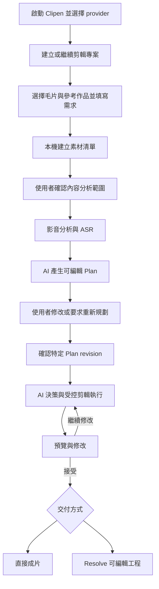
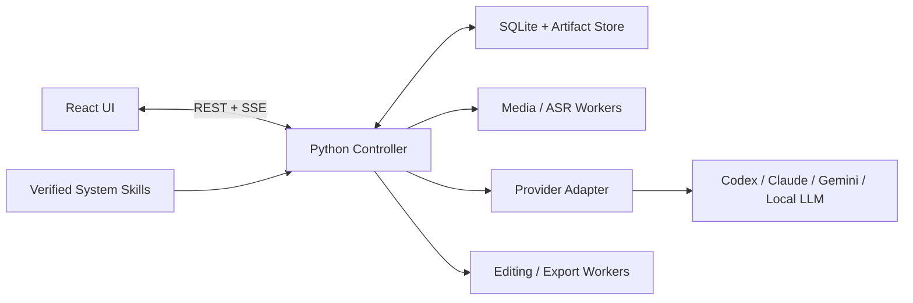
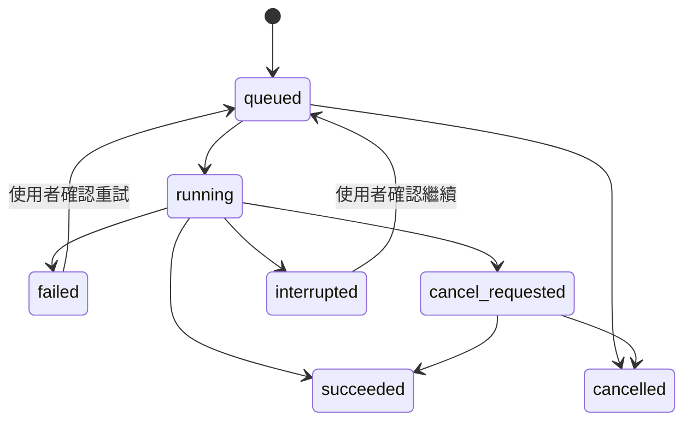

# Clipen 產品架構基準

本文件定義 Clipen 已確認的產品與系統邊界。它是後續設計、spike、實作與驗收的
共同依據，不是目前完成度清單。尚未通過實機驗證的能力必須明確標示，不能用原型、
合成結果或模型自述冒充完成。

## 1. 產品定義

Clipen 是由 terminal 啟動、在本機桌面瀏覽器操作的 AI 剪輯工作台。一份 Clipen
安裝可管理多個剪輯專案；Clipen 程式 repo 與使用者的剪輯專案是不同概念。

使用者提供毛片、可選的參考作品與剪輯需求。Clipen 在明確授權後分析畫面、聲音
與語音，讓 AI 依內部系統 Skills 產生本次作品的可編輯 Plan。使用者確認特定 Plan
版本後才開始剪輯，最後可交付直接成片或 DaVinci Resolve 可編輯工程。

產品介面以桌面為目標。手機版不在開發與驗收範圍；窄視窗只提供基本容錯，不建立
手機專用版面或操作承諾。

### 1.1 使用者入口

第一次從 source checkout 設定：

```sh
./install
```

設定完成後：

```sh
clipen codex
```

`codex` 表示本次選用的 AI provider。Clipen 啟動 Controller 與本機 UI，但不開啟
Codex 互動式 TUI、不注入對話、不建立 MCP 輪詢，也不要求使用者手動架設服務。
AI 只在 UI 明確授權一個分析、規劃或修改步驟後，以單次、有界的 Attempt 執行。

Terminal 只顯示產品狀態：

```text
Clipen 已啟動
AI：Codex 可用
UI：
http://localhost:4200
狀態：等待 UI 操作
按 Enter 重新開啟 UI · 按 Ctrl+C 關閉 Clipen
```

只關閉瀏覽器分頁不停止 Controller；使用者可回到 Terminal 按 Enter 取得新的短期
連線憑證並重新開頁。關閉執行 Clipen 的 terminal 會停止本機服務與 worker，保留
可核對、可續作的持久狀態。

### 1.2 完整產品流程



開啟 UI、儲存草稿、選擇目錄與建立素材清單都不代表已呼叫 AI 或開始剪輯。

## 2. 系統拓樸與責任



| 元件 | 負責 | 不負責 |
| --- | --- | --- |
| Launcher | 首次設定、runtime 驗證、provider 選擇、Controller 生命週期 | 啟動 AI 對話、修改 shell、暗中安裝或登入 |
| React UI | 作品操作、資料授權、Plan 編輯、進度、預覽與交付選擇 | 直接讀檔、呼叫 provider、執行 shell、修改資料庫 |
| Controller | 權限、版本、命令、排程、狀態、驗證、恢復與交付協調 | 將模型文字直接視為執行成功 |
| Provider Adapter | 核對能力、執行單一 AI Attempt、提交結構化候選結果 | 常駐輪詢、擴大資料範圍、自行批准下一階段 |
| Media Workers | FFprobe、代理檔、取樣、ASR、畫面與聲音分析 | 自行呼叫 AI 或修改原始素材 |
| Editing Workers | 執行受 schema 約束的剪輯描述、預覽與 export | 執行任意模型 shell 或未驗證 script |
| Artifact Store | 保存具 hash、版本與來源的衍生成果 | 把任意路徑當成受管理檔案 |
| System Skills | 內部流程與剪輯判斷方法 | 作為使用者可編輯 Plan 或 UI 可讀內容 |

AI 負責創作理解與決策；Controller 和受控 worker 負責檔案、影音處理、驗證與交付。

## 3. 桌面 UI 資訊架構

### 3.1 作品首頁

首頁顯示建立新作品、繼續最近作品、其他作品及需要處理的中斷狀態。每張作品卡
只呈現作品名稱、封面、最近更新、目前階段與主要下一步。技術 log、Attempt ID、
provider prompt 與開發資訊不進入首頁。

### 3.2 五階段作品工作台

工作台固定包含：

1. 素材
2. 分析
3. 計畫
4. 剪輯
5. 匯出

桌面版由左側階段導覽、中央工作區、右側狀態／屬性區及底部主要操作列組成。
完成階段可回看；未開放階段顯示缺少條件。每頁原則上只有一個主要下一步。

### 3.3 各階段行為

- **素材**：作品名稱、毛片、參考作品、需求、長度、比例、用途與素材摘要。大量
  檔名預設收合，問題與可用素材分開呈現。
- **分析**：顯示真正的處理階段、已完成成果、目前工作、暫停與需處理問題；不以
  terminal log 充當進度，也不顯示沒有依據的精確 ETA。
- **計畫**：結構化段落、候選素材、來源區間、字幕、字卡、節奏、聲音、插圖、
  效果、未知與衝突。可整體或局部要求 AI 重規劃，但不是聊天介面或完整 NLE。
- **剪輯**：處理中顯示可理解的工作階段；完成後以播放器、時間點／段落定位與
  修改面板進行下一輪 revision。
- **匯出**：同一接受版本可選直接成片或 Resolve 工程，事前顯示可編輯性檢查與
  不能保留為可編輯元素的限制。

### 3.4 全域 UX 規則

- 保存狀態區分保存中、已保存與結果未確認。
- 重新整理、重複點擊或分頁重連不能重複建立工作。
- 錯誤必須說明發生什麼、影響什麼、下一步怎麼做。
- 技術詳細資訊預設收合；正常操作不顯示 MCP、schema、request ID 或開發進度。
- 關分頁時，工作可在 Clipen terminal 存活期間繼續；關 terminal 則停止並保存狀態。
- 鍵盤操作、焦點管理、語意標記、色彩對比與桌面縮放列入驗收。

## 4. 持久化工作模型

### 4.1 核心資料

| 名稱 | 定義 |
| --- | --- |
| Operation | 使用者要求完成的一件持久工作 |
| Attempt | Operation 的一次真實執行嘗試 |
| Artifact | 不可變、具 hash、版本與 lineage 的成果 |
| Event | append-only 的狀態改變與重要事實 |
| Receipt | 冪等命令第一次接受後的持久回覆 |

Operation 類型至少包含素材清單、素材／參考分析、Plan 生成、剪輯、修改、成片匯出
與 Resolve 工程匯出。每個 Operation 綁定不可變的需求、素材、分析、能力、系統
Skill release 與 Plan revision 快照。

### 4.2 Operation 與 Attempt 狀態



- 相同 request ID 只回傳原 receipt，不重複開工。
- 重試同一輸入會建立新 Attempt；輸入改變則建立新 Operation。
- 付費 AI 或具有外部副作用的工作永不自動重試。
- `202 Accepted` 只代表命令已接受，不代表執行完成。
- AI 結果須通過 schema、素材引用、能力與 Artifact 驗證後才可標為成功。
- 取消是持久意圖；取消送出時工作可能已完成，必須核對真實結果。

### 4.3 Plan 版本

正在輸入的 Working Draft 可自動保存，但不因每次按鍵建立永久 revision。AI 生成、
使用者完成一輪修改、AI 重規劃、確認開始與預覽後修改都會建立不可變 revision。

```text
draft → ready_for_review → confirmed → executing → reviewed → accepted
```

Confirmed revision 永不原地修改。剪輯 Operation 必須綁定一個 confirmed revision。
執行期間可以準備下一版草稿，但不能改變正在執行的版本。所有成片與 Resolve 工程
都能追溯到同一 Plan revision 與 Artifact lineage。

## 5. API 與即時狀態

### 5.1 REST

GET 只讀取 project snapshot、materials、analysis、plans、operations 與 artifacts；
不得建立工作、呼叫 AI、修改檔案或重試失敗工作。

Mutation 使用明確 POST command，並包含：

```json
{
  "request_id": "unique-id",
  "expected_revision": 6,
  "consent": {
    "action": "analyze_materials",
    "provider": "codex",
    "data_scope_id": "scope-id"
  }
}
```

所有 mutation 驗證 session、CSRF、資料範圍、預期版本與 request ID。路徑選擇只
改變 UI draft；保存、建立素材清單與內容分析是三個不同命令。

### 5.2 SSE

第一版以 SSE 推送持久事件，不使用 WebSocket。事件至少包含 queued、started、
progress、artifact created、cancel requested、failed、succeeded 與 action required。
瀏覽器用最後 event ID 重連；事件缺口過大時重新取得 project snapshot。SSE 只推送
狀態，不能建立命令。

## 6. 資料授權與 Provider Adapter

### 6.1 三層資料範圍

| 層級 | 內容 | 預設 |
| --- | --- | --- |
| 專案資料 | 名稱、需求、目錄、狀態 | 本機 |
| 衍生成果 | 技術資訊、縮圖、ASR、分析、Plan | 本機 |
| Provider Payload | 單一 Attempt 明列且獲准的內容 | 依 provider 而定 |

Provider 不自動取得整個毛片目錄。Controller 建立 Input Manifest，只列出該 Attempt
允許讀取的 Artifact、brief revision、目的與 output schema。優先提供逐字稿、取樣、
聲音特徵與結構化摘要；若必須使用原始片段，UI 另行說明並取得授權。

### 6.2 Adapter 契約

所有 provider 實作：

```text
probe()
capabilities()
run(attempt, input_manifest, output_schema, cancel_token)
reconcile(attempt)
```

- `probe()` 只核對 executable、登入、非互動模式與能力，不呼叫模型。
- `run()` 建立獨立、有 timeout、輸出上限、取消與 schema 的程序；不啟動 TUI、
  不載入專案 MCP／其他 plugin、不等待永久工作佇列，完成後退出。
- `reconcile()` 根據持久輸出、程序狀態、hash 與 schema 判斷完成、失敗、中斷或未知；
  不依賴 provider 聊天歷史或模型自述。

Codex 的候選方向是受控非互動 `codex exec`，但正式參數、sandbox、schema、取消、
費用與登入行為必須由 isolated spike 實測後才定案。

## 7. System Skills

固定 core Skill 負責流程；其他 system editing Skills 提供內部剪輯判斷。Controller
在啟動與 Attempt 建立前驗證簽章、release hash、完整 inventory 與實際內容。

瀏覽器只取得獨立編寫的名稱、用途與可調參數，不取得原文。Plan、API、event log、
錯誤與 Artifact 不複製 system Skill 原文。使用者可編輯的是本次作品 Plan，不是
system Skill。

簽章與 UI 隱藏提供完整性與產品權限邊界，不是 DRM。任何隨公開 repo 或本機 runtime
發行的內容，都不能宣稱對本機管理員真正保密；若未來需要保密，必須改用受管理的
遠端服務或接受本機逆向風險。

## 8. 媒體、剪輯與 Resolve 交付

媒體分析必須實際處理畫面與聲音。ASR 產生帶來源時間、覆蓋範圍、語言與信心資訊
的逐字稿；缺少音軌、沒有人聲與辨識失敗是不同狀態。逐字稿不等於完整影音理解。

剪輯描述保存片段、軌道、文字、插圖、聲音、效果、來源與版本，不能包含任意 shell
或未驗證 Fusion script。來源時間保存 stream time base、原始 PTS、音畫起始偏移與
代理檔映射，時間軸使用整數 frame 與有理數 fps，不反覆用浮點秒數換算。

同一 accepted revision 支援直接成片與 Resolve 工程。可編輯工程須讓影片、音訊、
中文文字、插圖與已驗證效果保持獨立可編輯；不支援者在開始剪輯前說明，不能靜默
壓平。工程包須能在換路徑或離開本機快取後開啟，且不覆蓋使用者既有 Resolve 工程。

## 9. 中斷、恢復與 Temp System Log

關閉 Clipen terminal 時，Controller 保存狀態、發送停止意圖、等待受控 worker 停止、
記錄未完成或結果未知的 Attempt，然後關閉 UI。不在背景繼續 AI、轉檔或匯出。

重新啟動時：

- 重用已驗證 Artifact。
- 有 checkpoint 的本機分析可在使用者確認後接續。
- 中斷的 AI／付費工作不自動重送。
- 結果未知的外部操作先依 receipt、檔案與 hash 核對。
- 無法判斷時顯示「需要確認」，不能自行宣稱成功或失敗。

Temp System Log 是由 Event 與 Artifact 生成的恢復摘要，可描述上次停止階段、已完成
成果、待處理範圍與可重用資料。SQLite 與有 hash 的 Artifact 才是事實來源。摘要不
保存 provider 憑證、system Skill 原文、私人完整 prompt，也不能把使用者內容提升為
新的 system instruction。

## 10. `clean` 與 `reset`

### 10.1 `clipen clean`

清除可重新產生的 Clipen 資料，包括暫存、staging output、proxy、縮圖、預覽快取、
無引用 Artifact、過期 recovery 與 worker 暫存。保留 Project SQLite、需求、分析、
逐字稿、Plan、accepted revision、使用者匯出的成片／Resolve 工程、毛片與參考作品。

### 10.2 `clipen reset`

刪除單一剪輯專案的所有 Clipen 管理資料並從作品首頁移除，包括 Project SQLite、
Operation、Attempt、Event、分析、逐字稿、Plan、剪輯描述、proxy、預覽、快取與
recovery。永不刪除毛片、參考作品、使用者選擇的素材目錄、已匯出成品、Resolve
工程、runtime、shared model 或 provider 登入資料。

```sh
clipen clean --project <project-id>
clipen clean --project <project-id> --dry-run
clipen reset --project <project-id>
```

未指定 project 時使用互動式選擇；非互動 `--yes` 必須同時提供明確 project ID。
第一版不提供無確認的全專案 reset。

### 10.3 不碰毛片的硬性保證

- 清理器只接受 ManagedProjectId、ManagedArtifactId 或 ManagedCacheId，不接受素材路徑。
- 刪除操作只從已驗證的 Clipen 管理根目錄 directory handle 開始。
- 不跟隨 symlink，拒絕 hard link、mount point、`..`、跨 root、非預期 owner／permission。
- 不將資料庫任意路徑傳給 `rm -rf` 或其他通用遞迴刪除。
- 清理前鎖定專案、保存停止意圖並確認 worker 完全停止；無法停止則拒絕。
- Reset 先把受管理專案目錄原子移到 Clipen `.trash/<reset-id>`，再從該 root 清除。
- 測試用 source、reference 與 export sentinel 必須在各種損壞路徑、symlink、中斷、
  競態與重送案例後仍存在，內容 hash 與目錄結構不變。

## 11. 本機 UI 安全

- 只綁定 loopback，優先使用 `http://localhost:4200`；被占用時在有界範圍選擇下一個
  可用 port，不終止或干預占用者。私人 instance registry 讓重複啟動只重開同一個 UI。
- 首次開頁使用短期 bootstrap token，成功後改用 HttpOnly、SameSite session cookie。
- Mutation 驗證 CSRF、Host、Origin 與 Fetch Metadata。
- 使用嚴格 CSP、`no-store`、frame denial 與 MIME 防護。
- 私人完整重開連結只顯示於 Clipen terminal，不進 API、log 或錯誤回報。
- Browser 不取得系統 Skills、provider credential、任意本機檔案 API 或 shell API。

## 12. 安裝、建置與更新

Source checkout 的 `./install` 是首次設定入口。執行後先顯示 runtime、
全域 `clipen` 指令、PATH 設定檔、安裝位置與會／不會執行的操作，取得一次同意後
才安裝。設定完成後，新 Terminal 的入口統一為 `clipen codex`；正式發行仍可改由
Homebrew 或簽章 installer 提供該指令。

Source checkout 的對稱移除入口是 `./uninstall`。它只移除 Clipen 管理的 runtime、
本機模型、全域指令與 PATH 區塊，保留 `projects/`、provider Attempt 紀錄、毛片、
參考作品與匯出檔案。若 Controller 尚未停止、管理路徑不安全或同名指令不屬於
Clipen，uninstaller 必須拒絕執行；移除程式不等於刪除作品。

Launcher 不使用 `sudo`、不修改系統 Python、不設定 MCP，也不把 runtime 或模型
寫入 repo。Source bootstrap 只在使用者確認後，以有標記、可重複執行的區塊更新
目前 zsh 或 bash 的 profile，將 Clipen 私有 `bin` 目錄加入 PATH；不覆寫 symlink、
不完整標記或非 Clipen 管理的同名指令。Runtime 安裝在 staging 後原子切換，失敗
不留下半套可執行環境。

一般使用者不執行 `pip install`、`npm install` 或前端 build。React／TypeScript 原始碼
由 Vite 建置；production assets 隨 repo／runtime 交付並有 hash manifest。CI 重新建置
並確認 committed dist 與 source 一致。核心 ASR runtime 與固定語音模型在第一次設定
時一併下載；其他可選本機模型才延後下載。任何大型下載都要事前顯示大小、授權、
位置與刪除方式。

```text
~/Library/Application Support/Clipen/
├── runtimes/
├── projects/<project-id>/
├── models/
├── cache/
├── logs/
└── install-receipt.json
```

`clipen doctor` 永遠唯讀。Update 不在作品處理中自動執行；資料 migration 前建立
可驗證備份，新版啟動失敗可回復上一個 runtime。移除程式與刪除作品資料是不同操作。

## 13. 發布 Repo 邊界

可以發布：使用者導向 README、LICENSE、launcher、產品程式與測試、React source／dist、
API schema、migration、release manifest、公開驗證金鑰、產品架構、必要 system Skill
bundle、CI 與發行設定。

不得發布：個人開發 Skills、AGENTS／CLAUDE 指令、session probe、原生啟動實驗、PR／
branch 暫存、開發進度流水帳、本機 DB、素材、逐字稿、預覽、執行 log、benchmark
暫存、私人 signing key、provider credential、個人機器路徑、`.codex/config.toml` 與
`.mcp.json`。

Repo 首頁只說明產品、目前真實能力、安裝與回報方式，不放測試數量、內部原型、
實驗指令或 PR 進度。

## 14. 首個完整驗證範圍

- macOS Apple Silicon
- 桌面 Chrome 與 Safari
- Codex provider
- DaVinci Resolve
- 華語口播／教學短片
- 基礎字幕、字卡、插圖、音訊與可映射效果

Intel Mac、Linux、Claude、Gemini、Local LLM 與更多剪輯類型保留相同契約，但不與
首版一起承諾。手機與 Windows 不在首版範圍。

## 15. 實作前必須完成的 isolated spikes

以下尚未因文件確認而自動成立，必須以隔離環境及真實工具驗證：

1. Codex 非互動執行的登入、sandbox、結構化輸出、取消、timeout、錯誤與費用行為。
2. React production bundle 由受管理 Python Controller 提供、SSE 重連與瀏覽器恢復。
3. 簽章 standalone runtime 在乾淨 macOS 上的 clone／Homebrew 首次設定與原子更新。
4. 真實影音的 FFprobe、代理檔、華語 ASR、時間基準與中斷 checkpoint。
5. 真實 Resolve 小工程的影片、音訊、中文文字、插圖、效果、搬移、重開與渲染。
6. `clean`／`reset` 對惡意路徑、symlink、mount、損壞 DB、中斷與競態的毛片不變測試。

每個 spike 都要先寫驗收條件，只產出技術證據與決策；未通過者回到架構選項，不把
spike code 直接當產品實作。

## 16. 實作准入規則

完成本基準核准後，才將工作拆成可獨立驗收的實作批次。每批必須說明使用者價值、
資料 migration、失敗與回復方式、測試與人工驗收。不得把舊 MCP／互動 session 原型
遷入產品骨架，也不得因既有程式可用就讓資料模型依附原型。
