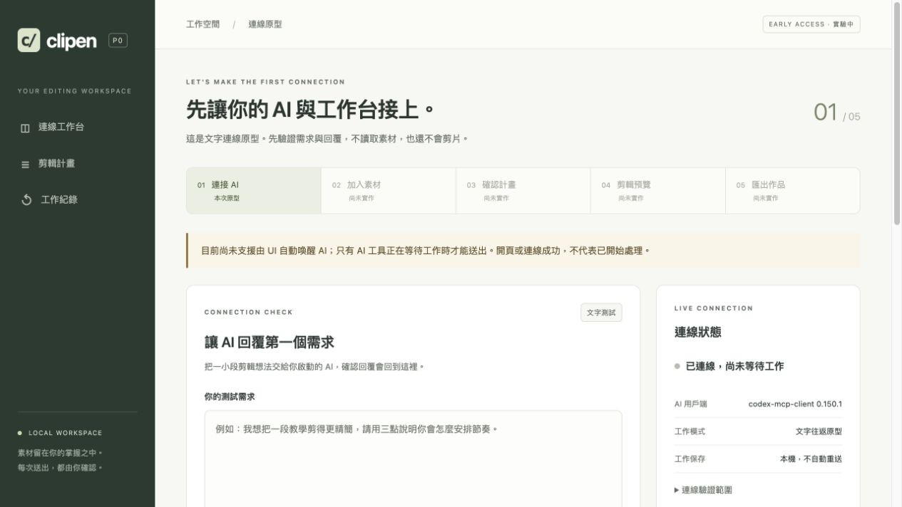
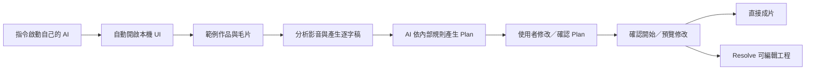

<div align="center">

# Clipen

**把參考風格變成剪輯，保留你接手修改的自由。**

自己的 AI · 本機操作介面 · 可編輯剪輯計畫 · Resolve 工程與成片

[產品流程](#產品流程) · [目前進度](#目前進度) · [開始驗證](#開始驗證) · [架構](ARCHITECTURE.md)

</div>

---

Clipen 是開發中的 AI 剪輯工具。目標是進入專案、以指令啟動自己的 AI，
接上後自動開啟本機 UI。提供需求、範例作品與毛片，修改並確認 AI 的剪輯計畫，讓 AI 完成初剪；
最後選擇直接出片，或交給 DaVinci Resolve 繼續編輯。

> **目前是早期開發階段，尚不能自動剪片。**
> 已有本機 UI、MCP 文字工作通道與系統 Skills 保護；真實 AI 完整往返、影音分析
> 及 Resolve 交付仍待驗證或實作。



*實際原型畫面：Codex 通道已連接，但 AI 尚未等待工作。不是剪輯成果或完整功能展示。*

## 產品流程



- **編輯本次計畫**：AI 根據需求、毛片分析與範例風格產生 Plan，使用者修改並確認。
- **系統規則留在內部**：系統 Skills 不在 UI 或瀏覽器 API 公開原文；Plan 不是規則副本。
- **剪完再選輸出**：工程中的影片、插圖、文字與支援的效果保持可編輯。
- **中斷可接續**：保存工作狀態，重連先核對，避免重複執行。
- **素材由你授權**：原始檔不覆寫；送給雲端 AI 的資料須明確確認。

以上為產品目標；本機 UI 不代表雲端 AI 也在本機執行。

**介面以桌面瀏覽器為目標，不開發或驗收手機版。** 保留桌面視窗縮放、
分割視窗與鍵盤操作所需的基本適應能力，不另做手機操作流程。

## 目前進度

| 功能 | 狀態 |
| --- | --- |
| 產品流程、模組與責任邊界 | 已定義，見[產品架構](ARCHITECTURE.md) |
| 1 個 core ＋ 4 個系統剪輯 Skills | 已建立，內容仍是草稿 |
| 系統 Skills 簽章驗證、禁止寫入、使用者隔離 | 已實作；21 項本機測試通過 |
| 本機 UI、文字工作佇列、停止收件、重啟保留紀錄 | 已有可執行原型，合成通道與瀏覽器測試通過 |
| 直接 `codex`／`claude` 開 UI | Codex 0.150.1 已實測啟動服務、輸出可用連結並列出 3 個工具；使用者預設瀏覽器自動開頁及 Claude 首次授權仍待驗收 |
| 狀態、草稿保留與效能 | 區分連線／等待接件、保留斷線草稿、同筆請求核對、條件式狀態更新與分批顯示 |
| Plan 生成、編輯與確認 | 已重新定義需求；原型只顯示未實作狀態 |
| 真實影音分析、ASR、自動剪輯 | 尚未實作 |
| Resolve 工程與成片 | 尚未實作，需真實可編輯性驗收 |
| 完整工作恢復與剪輯品質評估 | 尚未實作 |

目標 AI 入口為 Codex、Claude、Gemini 與本機 LLM；**目前不宣稱任一入口已通過
完整流程驗收**。先驗證 macOS 上的一條可用路徑，再擴展。

## 開始驗證

需要 Python 3.10+、支援 Ed25519 的 OpenSSL 及 POSIX；已在 macOS 測試，
Windows 尚不支援。不需安裝 Python 套件。

### 正式要支援的啟動流程

clone 本專案後，進入 **repo 根目錄**，直接開啟你已安裝並登入的 AI CLI：

```sh
cd clipen
codex
```

或使用 Claude Code：

```sh
cd clipen
claude
```

**不需要另外執行 Clipen launcher、手動起服務，或再輸入「幫我開 UI」。**
repo 的 `.codex/config.toml`／`.mcp.json` 註冊本機 MCP；支援的 CLI 在你批准
專案信任／MCP 後載入，完成初始化時自動啟動並開啟 UI。這兩份是可隨產品
分發的啟動設定，不是開發 Skills，不含私鑰或個人路徑。

目前狀態與前置條件：

- 需要 Python 3.10+ 在 PATH 中以 `python3` 執行，以及前述 OpenSSL／POSIX 環境。
- **Claude Code 2.1.229 已偵測到 repo 設定，目前等待使用者首次批准。**
- **Codex 0.150.1 已實測直接啟動本機服務與呼叫瀏覽器開頁**；先前 0.41.0
  未載入專案設定。升級後須退出舊 CLI 再開；專案本身不自動升級 CLI。
  已修正 MCP 工作目錄為 `.`（從 repo 根目錄啟動）。
- **已修正 `/mcp` 重複啟動造成 0 tools 的問題，原生 CLI 實測顯示 3 tools。**
  額外查詢程序只提供工具清單，不能讀取工作、開第二個 UI 或接管原連線；
  單 writer 保護仍然有效。
- 自動開頁只代表本機工具通道初始化；**UI 工作自動喚醒原 AI 與真實模型完整
  往返仍未驗收**。不因開頁就背景上傳資料、啟動模型輪次或開始剪輯。
- 只有 AI 工具正在等待工作、文字有效且勾選授權時才可送出；目前不能只靠
  UI 點擊啟動原 AI。這個 PR 範圍是通道原型，不是完整 P0-A 驗收。
- 同一 workspace 目前只能開一個原型。結束 CLI 會關閉它的 UI 服務並保留紀錄。

### 重開 UI 與關閉 terminal

啟動成功後，Clipen 會向本次 terminal 輸出 `http://127.0.0.1:<port>/#…` 的本機
連結；它只在這次 AI／UI 程序存活期間有效，可以重開分頁，請勿分享完整連結。
`127.0.0.1` 是本機 loopback，沒有開放到外網；每次重啟可能使用不同 port。

- 只關瀏覽器分頁：AI／服務仍在，可用同一完整連結重開。
- 關閉 AI terminal：服務停止、舊連結失效；已開分頁偵測到斷線後隱藏工作台，
  顯示「本機介面已停用」，不再輪詢或接受工作操作；尚未送出的文字可複製保存。
  瀏覽器可能保留這個停用分頁；草稿只留分頁記憶體，不寫入瀏覽器儲存空間。
- 再次啟動：使用新的 terminal 連結；已有紀錄保留，未完成工作先核對再重送。

終端顯示依 AI CLI 而異：全畫面重繪可能覆蓋輸出的連結；沒有控制終端的宿主
無法顯示這個提示。這些情況仍可使用自動開啟的分頁，不能宣稱所有 CLI 都已
完成連結可見性的驗收。詳見[原型使用說明](prototypes/local_ui/README.md)。

完整機制、相容性與首次授權見[原型使用說明](prototypes/local_ui/README.md)。
模型實際運作仍依你選用的 AI 服務計費；專案不會略過供應商權限提示。

<details>
<summary>只看 UI 的診斷命令（不是日常入口）</summary>

```sh
python3 -m prototypes.local_ui serve
```

此模式不啟動 AI，送出按鈕停用；以 Ctrl+C 關閉服務。

</details>

### 驗證 Skills 與執行測試

在 repo 根目錄執行：

```sh
python3 -m tools.skill_guard verify
python3 -m tools.skill_guard list
python3 -m unittest discover -s tests -p 'test_*.py' -v
node --test tests/test_ui.mjs
```

以上驗證／測試命令不處理私人影片、不呼叫 AI，也不產生 AI 服務費用。
目前 85 項 Python 測試與 10 項前端狀態測試通過，包含合成 HTTP／MCP、
系統內容不外送、程序生命週期、重送及效能工作量界線；不能代替真實 AI 或
Resolve 驗收。前端測試需 Node 20+（本機 20.19.1；CI 使用 22），日常 UI 不需要 Node。
已加入 macOS／Linux CI 設定；遠端結果以最新 PR checks 為準。
完整操作與保護限制見 [Skills 保護說明](docs/SKILL_PROTECTION.md)。

## 系統 Skills

| Skill | 用途 |
| --- | --- |
| `clipen-core` | 固定流程：授權、分析、剪輯、驗證與交付 |
| `clipen-clean-cut` | 清楚、自然的基礎剪輯 |
| `clipen-talking-head` | 口播與教學內容 |
| `clipen-story-vlog` | 敘事與生活紀錄 |
| `clipen-highlight` | 重點與精華片段 |

系統 Skills 位於 `skills/system/`，是內部產品規則；一般 UI 不顯示原文、不提供修改
或複製。使用者編輯的是 AI 為本次素材產生的 Plan。明文隨 repo 分發，檔案擁有者
仍能直接讀取；這不是內容加密或對本機管理員的保密保證。
簽章私鑰不隨產品發布。本機管理員仍能替換程式，保護機制不是 DRM。

## Repo 收錄原則

收錄產品程式、測試、系統 Skills、公開驗證資料與使用說明。
`ARCHITECTURE.md` 是公開產品基準；詳細開發規劃與開發 Skills 只留本機。

- `docs/` 預設不收錄，只有產品使用說明 `docs/SKILL_PROTECTION.md` 例外。
- `skills/dev/`、`skills/development/` 與專案內 AI 的開發 Skills 不收錄。
- 私鑰、Token、個人 AI 設定／對話、原始影音、逐字稿、模型、快取、log、
`.clipen/` 與輸出不收錄。產品系統 Skills 與簽章清單保留。
- `.gitignore` 不會清除既有 Git 歷史。提交前檢查暫存區；推送前檢查所有待推
  commits。若仍含開發文件，先停止並確認歷史整理方式。
- 未經明確要求，不自行 commit、push 或改寫歷史。測試資料使用合成或已授權內容。

推送前可執行唯讀檢查（`origin/main` 須是已存在且核對過的目標基準）：

```sh
python3 -m tools.release_audit
python3 -m tools.release_audit --base origin/main
```

第一個命令檢查目前檔案樹；第二個另查所有待推 commits，包含後來已刪除的
開發文件。掃描失敗時先停止發布；它不會改 Git 歷史，也不保證找出所有敏感內容。

問題與建議可透過 [Issues](https://github.com/IMGMANISME/clipen/issues) 提出。
請勿附上憑證、私人素材、逐字稿或未去識別的工作紀錄。
