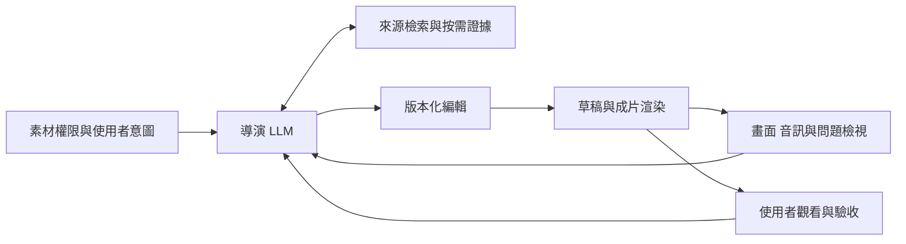

# Clipen：素材驅動的自主節目製作設計草案

日期：2026-10-20。狀態：規劃草案；不是已實作功能清單，也不是成片驗收。
參照 PR #29 的實作與 `REFACTOR_HANDOFF.md`。本文件不修改執行流程。

## 1. 產品目標與必須保留的方向

使用者提供素材、想做的內容與參考，LLM 自行找事件、理解人物與對話、組織故事、試剪、
安排字幕／音樂／畫面設計，輸出後檢視並修改，最後交付可播放與可編輯的影片。
目標是有人物、體驗、反應與節奏的節目，而不是依日期排列素材、加上字幕就完成。

- 不使用獨立字卡代替敘事；口語字幕、畫面內標註、重點指示與資訊元件仍有用途。
- 使用者明確要求音樂、剪輯、轉場時，必須實際交付並檢查結果；不可以用工具紀錄代替。
- 工具讓 LLM 決定如何剪，不預先寫死每段的模板、剪點或特效數量。
- 使用者的風格認可、文字核對、模型自評、技術檢查是不同事實，分別保存。
- 完整長片是產品目標。短樣片是驗證方法，不應成為所有模型、工具與資料結構的永久上限。

首個可驗收里程碑：一個沒有舊分析／舊計畫的新作品，可以直接製作完整後製樣片；
字幕同步、配樂可辨識、人聲清楚、畫面設計與事件有關，而且可用同一流程重現。

## 2. 對現況的判斷

| 現況與程式位置 | 造成的問題 | 設計決策 |
| --- | --- | --- |
| `agent_repository.create_run` 讀 current_timeline；schema 的 base_timeline_id 不可空 | 新工作必須先走過舊計畫與時間軸 | 新 session 可在沒有時間軸時建立 |
| `agent_tools._confirmed_input` 及 get_edit_status 綁 confirmed plan；UI 入口放在 TimelineValidationSection | LLM 尚未取證就先被舊計畫框住 | 啟動條件改為素材權限、意圖與預算 |
| 對話檢索只查既有 current_preparation | 沒轉寫過的素材，容易被誤當成沒有相關對話 | 查詢同時回傳覆蓋範圍、未知範圍與可執行的補證據工作 |
| ASR 視窗被當作 phrase/word；字幕依字數估時 | 摘錄與分頁後不同步 | 轉寫與對齊分離，字幕使用實際字／詞時間 |
| 配樂層存在與 gain 值即滿足需求 | 有放置但使用者聽不到，也可能被現場聲持續 duck | 檢查來源 stem、預期增益包絡與最終混音；另處理聽感驗收 |
| render_preview 同時檢查完成需求 | 缺音樂的粗剪無法先輸出來看 | 草稿可輸出；完成交付另設檢查 |
| `_recut` 會清除字幕、效果與音訊 | 小修改會丟失已完成的後製 | 以來源／片段／剪點錨定，計算受影響項目 |
| 逐鏡首中末與字幕中點覆蓋 | 能證明取樣，不能證明字幕同步、連續動作與聲音正確 | 加入時間區間、音訊證據與可用的感知輸入 |
| 30–75 秒、30 鏡、96 段文字等界限散落在樣片流程 | 單純加長片長會撞到字幕、渲染、上下文與預算限制 | 區分樣片執行政策與可擴展的作品模型 |

分析仍然必要。要移除的是把整批分析和確認計畫當成必經關卡的設計；
底層來源身份、語音、畫面與時間證據要變得更可靠，並能按需取得。

## 3. 主流程與責任

這張圖是可反覆的工作迴圈，不是模型每次必須依序走完的步驟。
LLM 可先看素材、先查一句話、先試一個剪點，或先比較兩種音樂。
本機負責可執行性、來源與權限、時間、儲存、預算及失效處理，不代替模型判斷故事。

系統按資源限制排程轉寫、取樣、渲染等工作；這不代表要同時啟動多個付費導演。
保留單一作品寫入序列，防止背景工作覆寫前景的編輯版本。

## 4. 分開保存的核心資料

| 資料 | 用途與權威 |
| --- | --- |
| SourceRevision | 檔案身份、串流、時間基準、可讀範圍；是引用素材的依據 |
| IntentRevision | 使用者的目標片長、風格、參考、必須有／不能有的內容；模型不能自行改寫 |
| ProductionSession | 使用哪份意圖、來源快照、能力與預算；可沒有初始時間軸 |
| EvidenceArtifact | 轉寫、語音活動、字詞對齊、影格、場景／人物觀察；帶來源範圍、模型版本與限制 |
| WorkingOutline | 模型目前的事件選擇、待查問題與故事假設；可修改，不需前置人為確認 |
| EditRevision | 實際素材範圍、聲畫軌、時間映射、圖形與聲音處理；可比較、撤銷、分支試做 |
| PreviewArtifact | 綁定精確 EditRevision、來源／素材資產及渲染配方的輸出與 stems |
| ReviewFinding | 哪個版本、哪個區間、看見／量到什麼問題、嚴重性、證據與狀態 |
| UserAcceptance | 使用者認可的是風格、這支影片、逐字稿還是混音；不得混成單一 approved |

所有來源範圍使用原生 PTS 與有理數時間基準；UI 的秒數只用於顯示。
來源字詞時間 → 剪輯片段 → 變速映射 → 成片影格必須有明確映射。
JSON 輸出仍可保留，但不應把整包模型敘述當作事實索引。

新增 session／revision 儲存模型，不直接把現有非空外鍵改成假時間軸或假計畫。
舊資料經讀取轉接器引用，保留原版本與出處；新資料不再要求 plan_id／plan_revision。
確切 migration SQL 在資料契約測試後設計，不在規劃時預先固定欄位細節。

## 5. 素材理解與檢索

### 最小啟動工作

素材目錄授權後，先做檔案登錄與必要 probe，保留檔名、錄影時間及其可信度、串流與長度。
這些工作不需要付費 LLM，也不需要預先看完整批素材。

### 按需證據

模型可要求來源清單／接觸表、指定區間影格、對話轉寫、語音活動、字詞對齊、
相鄰片段或同時段線索。每項回傳完整性與未知範圍；空搜尋結果不能等同「素材沒有這件事」。
長任務回傳 job handle、目前狀態與部分結果，可取消、重試及重用。
搜尋若只有一小部分轉寫覆蓋，必須明說覆蓋程度，讓模型決定是否擴查。

每個證據的快取鍵包括來源身份、範圍、演算法／模型版本、語言與相關修訂。
人工文字修訂會使對齊失效，不應使整個作品所有視覺證據失效。
未核對 ASR 保持草稿；語音對齊能改善時間，不能證明文字辨識正確。

### 事件與故事

事件是有來源支撐、可修訂的工作假設：人物在做什麼、期待什麼、經過什麼、反應是什麼。
同地點或相鄰日期只是檢索線索，不足以證明即時因果。
保留拍攝上下文與相鄰句，讓模型有機會發現新事件；不只在舊候選裡重排。

## 6. 工具契約：先做完整閉環，再擴大種類

以下是待設計的能力群，不代表這些新名稱已經實作；不以工具數量作交付指標。

| 能力群 | 必須能完成的工作 |
| --- | --- |
| 檢索與取證 | 列來源與覆蓋、讀相鄰上下文、取時間區間、啟動轉寫／對齊、讀取／取消工作 |
| 故事工作區 | 保存事件假設、證據引用、缺少的素材與可改變的工作綱要 |
| 聲畫剪輯 | 選源、插入、移除、裁切、重排、分割、保留來源 handle、分離聲畫、J/L cut 與 B-roll |
| 字幕 | 來源摘錄、正確時間映射、斷句、人物／情緒呈現、避免遮住人臉與畫面重點 |
| 聲音 | 公開音樂搜尋／比較、來源授權、配樂進退、原音／環境聲、降噪、EQ、duck、音量包絡與混音 |
| 畫面設計 | 來源錨定的指示、圈選、箭頭、局部強調、資訊標籤、比較畫面、構圖動態與必要遮罩 |
| 轉場與節奏 | 硬切、聲音先入／後出、合理的溶接／淡轉等；分清時間跳躍、視覺銜接與片尾 |
| 輸出與檢視 | 區間預覽、前後版本比較、聲音 stems、成片片段與量測、問題定位、交付打包 |

每個有副作用的操作都有 idempotency key、預期 revision、前置條件、實際差異與受影響依賴。
錯誤提供可以採取的下一步。模型不產生任意 shell／FFmpeg 指令；經過型別檢查的編輯表示交給編譯／渲染層。
未配置的能力明確回報 unavailable，不回傳空成功，也不偷偷改用未授權服務。

初版應選少量但可完整取證、執行、檢視、撤銷的畫面元素。不能只新增 schema 名稱，最後沒有實際成片。
複雜追蹤、生成配音、多機同步等各自列為後續能力，不混入第一個里程碑的完成宣稱。

## 7. 時間、依賴與局部修改

字幕以來源字／詞錨定；轉場以剪點錨定；人物／餐點指示以來源時間與畫面位置錨定；
節目固定識別與配樂段落則可有 timeline／episode 錨點。類型要明確。

裁切與重排時計算依賴差異：能映射的重新定位；無法保留的標為待修；必須失效的預覽移除驗收資格。
不能一律默默刪掉所有字幕與聲音，也不能留下已經對不到畫面的標註。
變速與交疊轉場都必須測試總影格數、聲畫同步、字詞位置與前後版本差異。

聲畫分離是 B-roll、J/L cut 與節目感的重要前提。新編輯模型不能繼續假設每鏡都只播放自己的原音。

## 8. 三個品質問題的具體處理

### 字幕

- 轉寫和對齊分開；長視窗不再假裝是逐字時間。
- 完整來源句先對齊，再依摘錄與斷句映射；停頓不平均分給每個字。
- 對齊不可靠時列出具體區間，允許先看標示待修的草稿，不能把它當成字幕完成版。
- 對齊結果保存模型版本、字詞範圍與驗證狀態；不因時間對齊而把 ASR 草稿改成已核對。

### 配樂與混音

- 分開保留 camera/dialogue、music、FX 及 final mix 的可檢查結果。
- 量測來源音量、實際增益、duck 包絡、成片峰值與局部音量；確認音樂有進入成片。
- 對話驅動 duck，而非讓所有現場噪音一直壓住音樂；有底限、attack/release 與可檢查的時間區間。
- 實際音樂標籤／授權與聽感分開；「japanese」搜尋命中不能證明曲子聽起來符合參考。
- 量測與相關性可以發現消失、過度壓低、爆音與時間偏移，不能單獨判斷好不好聽。

### 節目畫面

先決定這個瞬間要讓觀眾注意什麼，再選構圖、指示、標籤、比較或動態。
文字與數字需有來源，不能自己編價格、評分或人物發言。
每個元素有起迄時間、位置／錨點、進出動態與圖層順序；可檢查遮擋及在實際成片是否出現。
不把「每鏡加一個特效」或「累積三個元件」當成節目感驗收。

## 9. 必須先攤開的感知限制

目前導演 adapter 接收文字與影格，沒有可用的音訊聆聽輸入。
再增加一個只讀相同文字與截圖的模型評語，也不能證明它聽到了音樂或看完連續動作。

規劃以原片／音訊預設留在本機為邊界。兩條路需要明確取捨：

- 維持現有 adapter：依本機轉寫、對齊、量測與影格做決策，音樂風格、對白自然度及連續聽感仍由人驗收。
- 加入真正的影音感知 adapter：須先驗證實際支援的輸入與回傳能力，再定義資料外送、片段範圍、費用、保存與失敗處理。
  若需要雲端服務，須另取得具體外送授權；既有縮圖／逐字稿同意不視為完整音訊上傳同意。

這項決策影響能承諾的自主程度，必須在擴展完整長片之前解決。規劃本身不代表已核准外送或選定供應商。
本機 forced-aligner 的下載／WIP 已存在，但尚未完成實際驗證與正式整合，不能拿來宣稱字幕問題已解決。

## 10. 驗證分層與產品狀態

| 檢查層 | 會阻止什麼 | 例子 |
| --- | --- | --- |
| 可執行性 | 阻止對應渲染／操作 | 來源越界、無權限、壞檔、無效時間與參數 |
| 需求完整性 | 阻止標示交付就緒，不阻止合理粗剪預覽 | 要求配樂但沒做、字幕待對齊、要求畫面元素但未完成 |
| 品質問題 | 依嚴重性阻止交付，或呈現待驗收 | 聲音被蓋住、字幕錯位、文字無依據、遮住人物 |
| 使用者驗收 | 決定是否接受作品／風格 | 故事成立、節奏自然、元素合適、聽感可用 |

建議 UI 狀態為：工作中、草稿可觀看、待修正、待驗收、已接受；技術渲染成功獨立顯示。
模型不能自行把自己升格為使用者已接受。不能以一句「待核對」消除已知嚴重問題。
已知問題必須連到確切版本與時間；清除問題需要修改或新證據，不只改評語。

## 11. 執行順序與每一步的退出條件

| 階段 | 工作與依賴 | 退出條件 |
| --- | --- | --- |
| M0：可行性與失敗基準 | 保存已知壞樣片與人工標記；用短來源片段驗證對齊、混音及一個實際畫面元件；決定音訊感知邊界 | 能重現並修正三種真實問題，留下原始證據與前後比較；失敗則先處理能力問題 |
| PR1：啟動與資料解耦 | 建 ProductionSession／Intent／可空草稿、新入口與舊資料轉接；依 M0 的契約 | 從未分析、沒有 plan/timeline 的作品能開始取證；取消、重啟與回退不損失舊作品 |
| PR2：按需證據 | 工作 handle、覆蓋台帳、快取失效、轉寫／對齊、查詢未知範圍；接入 M0 已驗證能力 | 冷啟動可發現原本沒有逐字稿的事件，無假完整性，字幕對齊測試通過 |
| PR3：編輯與渲染核心 | 聲畫分軌、穩定錨點、局部修改與區間預覽；舊工具經轉接器復用 | 修一個剪點不丟失其他後製；跨格率、變速與轉場不漂移 |
| PR4：完整聲畫製作 | 聲音進退／stems／混音檢查、少量完整視覺元素、模型能力回饋 | 真實字幕、音樂及畫面問題可被定位並修正，輸出內容符合本次明確需求 |
| PR5：真實自主驗收與主入口切換 | 套用下節固定評估集，取代舊 UI 必經步驟；保留舊結果入口 | 同一套流程可重現可接受樣片，沒有外層對話代選鏡頭或手改時間軸 |
| PR6：完整長片 | 事件／章節層編輯、連續音樂、全局敘事、分段快取與合成；依 PR5 | 目標片長影片可恢復、可局部重做、全片同步且接受敘事與聽音驗收 |

這是工程實作的依賴順序，不是使用者必須經歷的七道產品流程。
不要同時重寫儲存、來源掃描、所有模型與整個 renderer。沿用驗證過的來源開啟、FFmpeg、授權與版本執行能力。
日期與費用估算應在 M0 量測首用模型準備、實際推論、渲染及上下文成本後補入，避免現在承諾沒有依據的工期。

## 12. 驗收資料與初始門檻

以下是建議的首輪門檻，需用固定標記集校準；不是宣稱已達到，也不是通用產業標準。

- 冷啟動：刪除測試作品的舊分析／計畫前置資料仍可完成工作；不靠製造假計畫繞過。
- 字幕：包含中文、混合外語、長停頓、截取句、跨鏡與摘錄；人工標出起迄。初始目標起／迄誤差 p95 不超過 200 ms，
  且不能跨到下一句／下一事件；文字正確性獨立核對，測試不能只比較自己生成的時間。
- 聲音：合成分頻測試驗證來源、duck、音樂進退與漏音；真實資料保留 stems 和量測，逐段聽到音樂且人聲清楚。
  測試應能抓到「有音樂層但成片聽不到」的既有失敗，不只斷言 FFmpeg filter 字串。
- 畫面：在宣告作用的影格檢查實際像素／區域、來源錨點、字幕／人臉遮擋；元素須在觀看時有用途。
- 敘事：觀眾能說出這段發生什麼、期待和回應如何連起來；不能只驗證 setup/experience/payoff 三個欄位存在。
- 自主重現：先選至少三種事件，例如用餐、街頭互動、移動／場景；每種跑兩次，共六次，保存所有成功與失敗及成本。
  初始目標至少五次達使用者可接受方向，且交付就緒版本不能有已知字幕不同步／配樂消失等嚴重問題。
  由外層人工代剪或挑掉失敗不計成功；測試集與標記另存，不把私人素材提交 repository。
- 修改與恢復：對已完成樣片改一個剪點、一句字幕與一段音量，確認其他元素仍有效；中斷／重啟不自動重送付費工作。
- 長片：不能只調高片長常數；必須覆蓋字幕數量、分段邊界、音樂連續性、全局故事與總渲染同步。

現有 479 項測試作為相容回歸基線，不作為重構成片品質的成功率。

## 13. 預算、隱私、恢復與相容

- 每次工作固定來源授權、意圖與預算快照；可再取得使用者明確新增範圍，模型不可擴權。
- 本機工作與付費推論分開記帳；input、cache、output 與未取得用量分開呈現，處理總量不冒充同額花費。
- 對證據／預覽使用內容快取與區間重做；避免模型反覆讀整份素材／舊計畫或重跑已完成分析。
- 預算不足時保存可恢復草稿與待辦，不降低品質檢查來假裝完成，也不自動無限重試付費工作。
- 保留來源、字幕修訂、音樂權利與變更紀錄；音樂下載與本機模型版本固定、可驗證、可取消。
- 模型輸出只能操作授權 ID 與型別化參數，不能把素材內的文字當成系統指令。
- 新舊流程可切換；新成果用新 session 格式保存。回退舊程式時不要求它讀懂新格式，也不破壞原作品。
- PR #29 保存重構前的實作基準；依使用者決定合併，已知品質問題與重構待辦仍保留，不視為成片驗收。

## 14. 第一個實作決策

先執行 M0，產出「真實失敗 → 可觀測原因 → 局部修正 → 可重現結果」的證據，
再確定 session／工具／渲染契約並開始 PR1。這能避免解除舊流程後，只把相同的字幕與混音錯誤搬進新架構。

在選定具體音訊感知方案前，維持原音／影片留在本機的預設；外送權限與費用不能靠規劃文字默認。
規劃的完成不等於已取得執行新一輪付費驗證的授權。
